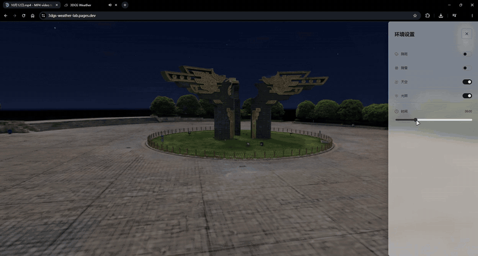

# 3DGS Weather

**简体中文** | [English](README.en.md)

以3DGS呈现场景，结合碰撞网格（Mesh）提供碰撞检测与深度遮挡支持，实现雨雪、积水反射、动态光照与阴影效果。

[在线示例](https://3dgs-weather.pages.dev/)

[](https://3dgs-weather.pages.dev/)

## 功能

- 动态天空、雨雪与雷电
- 积水反射、涟漪与积雪压痕
- 昼夜光照、阴影与车辆灯光
- 角色漫游与车辆驾驶

## 本地运行

```bash
npm install
npm run dev
```

## 技术栈

TypeScript、Vite、Three.js、Spark、three-player-controller。

## 致谢

第三方代码与资源来源见 [THIRD_PARTY_NOTICES.md](THIRD_PARTY_NOTICES.md)。
